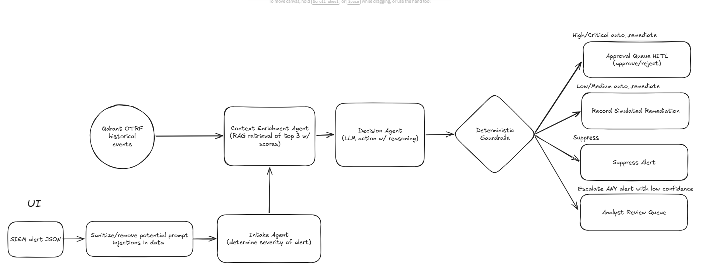

# SOC Alert Triage Pipeline

This project uses multiple AI agents to help a security operations center (SOC) review SIEM alerts. It classifies how serious an alert is, finds similar recorded events, and recommends whether to escalate, suppress, or remediate the alert. The AI does not get to make these decisions without checks. Python guardrails control the final route, and eligible High or Critical remediation proposals require human approval.

The system uses LangGraph to connect the steps, Qdrant to search past event data, and a Gradio interface for analysts. It supports Anthropic, GPT, and vLLM models.

## Quick start

```bash
# Install dependencies and set up API keys
pip install -e ".[dev,anthropic,openai]"
cp .env.example .env  # add API key for the providers

./scripts/start_local.sh up
./scripts/start_local.sh ingest

# Runs on http://localhost:7860
python -m soc_triage.ui
```

### Faster Docker development

The Dockerfile installs dependencies from `pyproject.toml` before copying the
application source, so a code-only rebuild reuses the dependency layer. For
frequent edits, start the app once with the development override, which mounts
the source and demo alerts into the container:

```bash
docker compose -f docker-compose.yml -f docker-compose.dev.yml up -d --build app
```

After editing Python or UI source, restart only the app process without a build:

```bash
docker compose -f docker-compose.yml -f docker-compose.dev.yml restart app
```

Changes to `pyproject.toml` or the Dockerfile still require a rebuild. Restarting
the app clears the in-memory approval and analyst review queues; the Qdrant
volume is separate and is not changed by these commands.

## Architecture



The workflow is defined in `soc_triage/graph.py`. It follows a fixed sequence of steps:

1. **Intake:** An LLM reads the cleaned alert and predicts its severity and confidence. It does not see the severity label originally assigned by the SIEM, so it has to make its own assessment.
2. **Enrichment:** The system searches Qdrant for the three most similar recorded events. This step uses embeddings rather than an LLM.
3. **Decision:** Another LLM uses the alert, intake result, and retrieved events to propose an action. It can also search for more similar events using a tool.
4. **Guardrails:** Python rules check whether the proposal is safe enough to follow. The rules can block suppression or remediation and send the alert for analyst review instead.
5. **Routing:** The alert goes to simulated remediation, suppression, analyst review, or a human approval queue, depending on the proposal and guardrail result.

`TriagePipeline` passes the alert and results between these steps. The intake and decision components are LangChain agents, while retrieval, guardrails, and routing use regular code.

## Design Choices

### Fixed workflow instead of autonomous supervisor or orchestrator agent

I use a directed acyclic graph (DAG) because alert triage already follows a known process. Every alert needs classification, additional context, a proposed decision, and safety checks. Allowing a potentially stochastic AI supervisor or orchestrator agent to invent its own sequence would add complexity in this case, although I could see for a task that requires Natural Language input, a more flexible approach might be beneficial. A fixed graph also makes it easier to test each step and see why an alert reached a particular outcome.

### The AI recommends actions, but code enforces safety

The LLMs are useful for interpreting alerts and suggesting responses, but their output is not an action. `apply_guardrails()` in `soc_triage/guardrails.py` checks each proposal using fixed Python rules. To be eligible for automatic remediation, the decision confidence must be at least 0.8, intake confidence at least 0.6, and retrieval must include a sufficiently similar event of the same type. There must also be no detected prompt injection, and the affected asset cannot be marked `crown-jewel`.

If any requirement fails, the alert goes to analyst review. Confidence and similarity scores determine routing. Keeping these rules separate from the LLM means I can test them directly and prevent the model from overriding them through its response.

### Human approval is part of the workflow

A High or Critical remediation proposal goes to a human approval queue rather than being executed. A Low or Medium proposal goes to a simulated remediation step assuming the confidence is high enough. The model can also request analyst review directly at any severity if it is not confident enough. The approval requirement is enforced by the graph, not just written in the LLM prompt. However, for the demo, an approved action does not change a real host.

### The system handles failures conservatively

If intake fails to return a valid result after a retry, the system treats the alert as Critical with zero confidence and sends it for human review. If the decision agent fails, the alert is escalated. If retrieval is unavailable, suppression and automatic remediation are blocked. This is because when the system is uncertain or a component fails, it should ask a human rather than take a potentially unsafe action.

I also treat alert text as untrusted. Fields are cleaned and length-limited, and suspicious instructions in an alert are flagged. Prompts tell the LLM to treat alert content as data, but the guardrails also add extra protection against unsafe decisions.

### Retrieval and models are kept easy to test and replace

Qdrant stores embeddings of recorded events and returns similar examples with similarity scores. Retrieval is a normal search step rather than an agent making its own judgment. The decision agent can request another search, but the guardrails use the results from the fixed enrichment step.

The selected LLM backend is in the UI. `TriagePipeline` also receives its model, embedder, data store, audit log, and approval queue as inputs. Qdrant can run as a server for the main application or as an embedded store for small tests.

## Data and evaluation

The Example alert dropdown includes two clearly labeled synthetic cases in
`data/synthetic_demo_alerts/`: a browser-setting cleanup intended as Low and a
user-level startup entry cleanup intended as Medium. They are designed to
exercise the eligible auto-remediation route, but model decisions can vary.
These cases are not in the OTRF holdout or Qdrant collection.

I use public Windows telemetry from [OTRF Security-Datasets](https://github.com/OTRF/Security-Datasets). The ingestion code in `soc_triage/rag/ingest_otrf.py` loads selected events from eight recorded captures into the Qdrant collection `otrf_recorded_events_v1`. Five of them are kept to be used as demo alerts in `data/otrf/demo_alerts/`.

Because these are recorded events, not analyst-reviewed incident reports, they do not come with verified severity or remediation labels. A similar retrieved event can give the model context, but it can't establish whether a proposed action is "correct". However, depending on the use case, this could definitely be something that could be changed as I could potentially add human reviewed labels back into the dataset in the future.

## Audit trail and current limitations

Each workflow step writes an audit event. The UI also records approvals, rejections, and analyst acknowledgements. Local runs create `./audit.jsonl` and Docker runs write `/app/audit.jsonl` inside the app container. The Docker audit file is not displayed in the UI and is not shown outside the container, so replacing the container may delete its history.

This project is a prototype, and is definitely far from a production SOC system. All the queues are held in memory instead of in a persistent database like AWS RDS, the UI has no authentication, and remediation is simulated. I would also need to add persistent queues and audit storage, access controls, least-privilege credentials, stronger testing with analyst-labeled alerts, and an evaluation set that includes adversarial inputs. I could also add rate limiting and review samples of suppressed alerts to check for missed threats.
